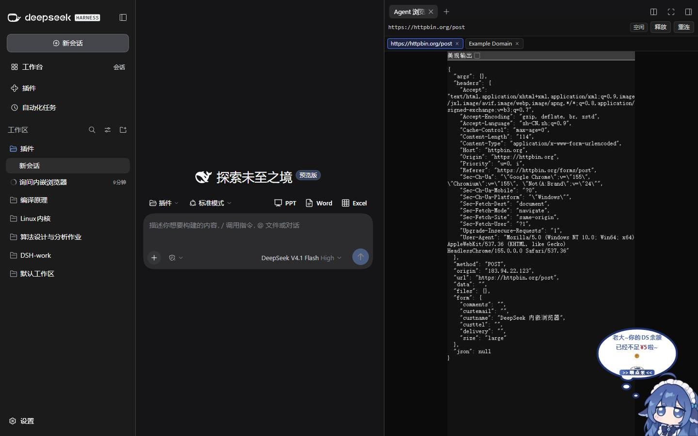

# dsh-agent-browser

给 DSH 加一个「agent 可共用」的浏览器：右侧栏里是一个真实 Chrome/Edge 的画面（像素流），模型通过 `browser_*` 工具操作**同一个**页面。人和 agent 看到的是同一屏、同一份登录态。

> 状态：P0+P1 已验收（2026-11-16，9/9 通过）。host 半 + client 半 + 引擎 + 自研 WS/租约全部落地。
> **怎么用（给人看的）**：[`docs/usage.md`](docs/usage.md)；设计文档：[`docs/architecture.md`](docs/architecture.md)。



> 说明：「共享登录态」目前指**同一个浏览器 profile**（插件自己的 profile，可长期登录）；接你日常 Chrome 的登录态属于尚未实现的 Copilot 档位。

## 它和内置 Browser tab / Playwright MCP 的区别

| | 内置 Browser tab | Playwright MCP | 本插件 |
|---|---|---|---|
| 人能看见 | ✅ | ❌ | ✅ 右栏实时画面 |
| agent 能读页面 | ❌ | ✅ | ✅ 快照（e1..eN 引用） |
| 共享人类登录态 | ✅ | ❌ 独立 profile | ✅ 同一浏览器 profile |
| 同一屏协作 | — | — | ✅ 租约（人类可抢占） |

## 结构

```
dsh-agent-browser/
├── lib/
│   ├── engine.js    零依赖 CDP 客户端：起浏览器、screencast、快照、点击/输入/滚轮/截图
│   ├── ws.js        零依赖 RFC6455 WebSocket 服务端（帧中转）
│   ├── lease.js     租约：单写者 + 人类抢占 + TTL（agent 30s / 人类 120s）
│   ├── index.js     host 半：HTTP 路由 + WS upgrade + 12 个工具
│   └── client.js    client 半：右栏 tab（手写 ModuleLoader bundle，只依赖 react）
├── package.json
└── cordis.patch.yml
```

数据流：`Chrome --CDP--> host(engine) --WS 二进制帧--> client `；人的点击/滚动 → `POST /agent-browser/api/command` → CDP；agent → 工具 → 同一个 engine。

## 工具

| 工具 | 作用 | 租约 |
|---|---|---|
| `browser_open(url)` | 打开网页并返回快照 | 获取 |
| `browser_snapshot()` | 读当前页面（地址/标题/正文/交互元素 eN） | 不占 |
| `browser_navigate(url)` | 跳转 | 获取 |
| `browser_click(ref \| x,y)` | 按 eN 引用或视口坐标点击 | 获取 |
| `browser_type(ref, text, clear?, submit?)` | 聚焦并输入（中文走 `Input.insertText`） | 获取 |
| `browser_press(key)` | Enter/Tab/Escape/方向键等 | 获取 |
| `browser_scroll(deltaY)` | 滚动 | 获取 |
| `browser_screenshot(full_page?)` | 截图存盘，返回路径 | 获取 |
| `browser_wait_for(selector? \| text?, timeout_ms?)` | 等元素/文本出现；超时返回 `found=false` 而不是报错 | 不占 |
| `browser_tabs(action, url?, tab_id?)` | `list` / `new` / `select` / `close` 标签页（不许关最后一个） | 写操作获取 |
| `browser_eval(expression)` | 在页面执行 JS。**默认关闭**；开启后每次都要右栏批准 + 写审计 | 获取 |
| `browser_release()` | 释放租约 | 释放 |

租约被占时工具**不会**硬失败重试，而是返回中文提示（谁在占用、可以先 snapshot 观察），避免两个 agent 互相打断。

### 审批与审计（P1）

`browser_eval` 默认 `allowEval: false`（工具存在但调用会直接报「已被配置关闭」）。显式打开后：

1. agent 调用 → host 通过 WS 广播 `{type:"approval", id, title, detail}`；
2. 右栏 pane 弹出遮罩卡片（标题 + 等宽字体显示待执行表达式），用户点「允许执行」或「拒绝」；
3. 结果回到 host：允许 → 在页面求值；拒绝/超时（`evalTimeoutMs`）/没有打开的客户端 → 抛错给模型；
4. 无论批准与否都追加一行 JSON 审计：`{at, kind:"eval", owner, expression, approved, reason}`，默认 `profileDir/../audit.jsonl`。

## 安装（当前机器已装好，这里是复现步骤）

1. 插件目录放到任意位置（如 `D:\插件\dsh-agent-browser`）。
2. 在 profile 里建 junction：
   ```powershell
   $prof = "$env:APPDATA\dsh-desktop\harness\profiles\web"
   New-Item -ItemType Junction -Path "$prof\node_modules\dsh-agent-browser" -Target "D:\插件\dsh-agent-browser"
   ```
3. 把包名加进 `profiles\web\package.json` 的 `dsh.profile.bundles`：
   ```json
   "dsh": { "profile": { "bundles": [ "...", "dsh-agent-browser" ] } }
   ```
   （不要带 UTF-8 BOM，profile manifest 的 `JSON.parse` 会失败。）
4. 重启 DSH Desktop（host 半的代码改动需要重启；client 半刷新页面即可）。
5. 右栏 `+` 里出现「Agent 浏览器」。

### 回滚

```powershell
$prof = "$env:APPDATA\dsh-desktop\harness\profiles\web"
Remove-Item "$prof\node_modules\dsh-agent-browser"   # 只删 junction，不删目标
# 从 package.json 的 dsh.profile.bundles 里去掉 "dsh-agent-browser"
```

备份在 `D:\插件\tmp\cordis.patch.yml.bak` 与 `package.json.bak`。

## 配置（cordis.patch.yml 的 config）

| 键 | 默认 | 说明 |
|---|---|---|
| `viewportWidth` / `viewportHeight` | 420 / 860 | 右栏视口（与像素流一致，点击坐标按此换算） |
| `headless` | `true` | 无头；调试可设 false 看真窗口 |
| `executablePath` | 自动探测 | Chrome/Edge 路径；自动探测不到时填 |
| `profileDir` | `%LOCALAPPDATA%\dsh-agent-browser\profile` | 浏览器用户目录（登录态存这里） |
| `frameQuality` / `maxFps` | 55 / 30 | 像素流质量与帧率上限（超过丢旧帧；实测 420×860 滚动可出 40+ fps，30 为清晰度/带宽平衡点） |
| `idleCloseMs` | 600000 | 无人连接时自动关浏览器 |
| `agentLeaseMs` / `humanLeaseMs` | 30000 / 120000 | 租约 TTL |
| `allowEval` | `false` | 是否允许 `browser_eval`；打开后每次调用仍需右栏批准 |
| `evalTimeoutMs` | 60000 | 等用户批准的超时 |
| `auditLog` | 空 | 审计日志路径；空则写 `profileDir/../audit.jsonl` |

## 安全边界

- 只允许 `http://` / `https://`（含 loopback），拒绝 `file:`、`data:`、内嵌凭据 URL。
- 浏览器是**独立进程 + 独立 profile**，不是 DSH 的 Electron 窗口，页面 JS 碰不到 DSH 的 origin。
- HTTP 路由与 WS upgrade 都先过 `ctx.connection.requestRejection(req)`（DSH 的会话认证）。
- `browser_screenshot` 只写插件自己的 shots 目录。
- `browser_eval` 默认关闭；开启后每表达式都要用户点「允许执行」，并写审计（表达式 + 批准结果 + 谁发起的）。

## 已知限制

- 像素流是 420×860 的手机式视口（右栏宽度决定），不是桌面全宽。
- 页面若在 iframe 内部，快照脚本只覆盖主框架。
- 首帧要等浏览器进程冷启动（约 1–3s）。
- `browser_wait_for` 轮询间隔 150ms，超时上限 60s；`browser_eval` 审批只在右栏 pane 打开时可用（否则直接报"没有客户端"）。

## 排错

- `%APPDATA%\dsh-desktop\logs\harness.log`：host 半日志（`agent-browser:` 前缀）。
- 右栏 tab 不出现：确认 client 半 bundle 在 `__DSH_BOOT__` 里（`curl` 首页 HTML 搜 `dsh-agent-browser/client.js`），且需刷新页面。
- 工具调用报 `output.render returned non-lossless JSON`：`render` 签名必须是 `(args, value)`，别把入参当输出。
- 浏览器起不来：`DevToolsActivePort` 残留会被清掉；再不行查 `executablePath`。

## 开发与测试

离线测试**不需要安装 DSH、也不需要 Chrome**（脚本会自己生成 `@deepseek-ai/*` 的测试 shim，仅用于解析 import）：

```powershell
node test/run.mjs          # 租约 + WebSocket + 插件契约，期望 21/21
node test/run.mjs --unit   # 只跑纯 JS 单测
```

需要真实浏览器的集成测试（会启动本机 Chrome/Edge）：

```powershell
node ..\spike\host-apply-test.mjs   # 期望 33/33
```

## 许可证

Apache-2.0，见 [LICENSE](./LICENSE)。


本项目参加 2026 华中科技大学优秀开源项目征集与评选（原创开源软件项目赛道）。